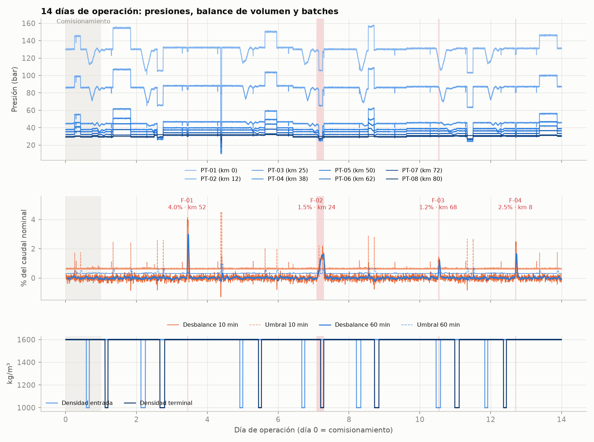
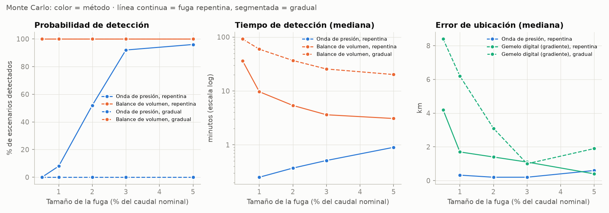
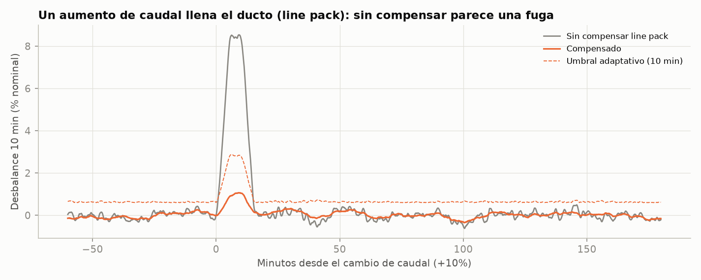

[Español](README.md) · **English**

# Monitoring a concentrate slurry pipeline

I wanted to understand how leaks are detected and located in a slurry pipeline: what data the SCADA system provides, why two different methods are used, and how all of that ends up on an operations dashboard. There is no public data from mining pipelines, so I built a simulator and worked with synthetic data.

The case is a fictitious 80 km copper-concentrate pipeline with 8 pressure transmitters, flowmeters at the inlet and outlet, and 14 days of data at 1-second resolution. Over those 14 days there are flow changes, pump rotations, water batches, two instrument failures and four leaks.

**Dashboard:** https://johnmoya.github.io/slurry-pipeline-monitor/



## What it does

- **Simulator** (`src/simulator.py`): generates the pressure at each station from Darcy-Weisbach, the elevation profile and the density of each batch. Leaks and operational changes produce pressure waves that travel at ~1,000 m/s. It also simulates line pack and instrument noise.
- **Digital twin**: the same hydraulic model, fed only with measured signals, estimates what the pressure at each station should be. It is calibrated on day 0.
- **Volume balance**: compares inlet and outlet flow, corrects for line pack and uses 2, 10 and 60-minute windows.
- **Pressure wave**: looks for negative pressure steps at each transmitter and locates the origin from the arrival times. If the origin is at the pump or the terminal, it is an operational event and is discarded.
- **Location from the hydraulic gradient**: slow leaks don't generate a wave, so the twin's residual is used to find where the slope of the hydraulic gradient changes.
- **Operating envelope**: MAOP by segment, minimum line pressure and deposition velocity.
- **Output**: a web dashboard, a star schema in CSV and SQLite for Power BI, and DAX measures.

## Results

| Leak | Type | Size | Actual km | Detected by | First alarm | Estimated km | Error |
|---|---|---|---|---|---|---|---|
| F-01 | Sudden | 4.0 % | 52.3 | Wave + balance | 34 s | 52.0 | 0.35 km |
| F-02 | Gradual (3 h) | 1.5 % | 23.6 | Balance | 71 min | 19.8 | 3.8 km |
| F-03 | Sudden, with a water batch in the line | 1.2 % | 67.8 | Wave + balance | 18 s | 68.3 | 0.5 km |
| F-04 | Sudden, 8 km from the pump | 2.5 % | 8.4 | Balance | 5 min | 9.3 | 0.9 km |

All four leaks were detected with no false alarms over the 13 monitored days. 23 operational transients (pump rotations and terminal valve adjustments) were correctly discarded.

To see how well it works outside this scenario, I ran 250 scenarios with leaks from 0.5 to 5 % at random locations, plus 30 days without any leak:

- The pressure wave is very fast (median under 1 minute; the slowest case took 1.3 min) and precise (median error of 0.2 to 0.6 km), but it only sees sudden leaks: 52 % of the 2 % leaks and 92 % of the 3 % leaks.
- The balance detected all of them, even the 0.5 % leaks, but more slowly. The median was about 4 min for a sudden 3 % leak and about 92 min for a gradual 0.5 % leak, which took up to 2.4 hours in the worst case.
- Leaks that only the balance sees are located with the twin. From 3 % up, the median error is 2 km or less. For small leaks the residual gets mixed up with the model error: for a gradual 0.5 % leak the median error is 8 km, and in some cases the location is not useful.
- In the 30 leak-free days there were no confirmed false alarms. There were 2 wave warnings without an imbalance, which are left as notices for the operator.



## Things that didn't work the first time

This is the part I learned the most from.

**Line pack.** The first version of the balance raised an alarm at every flow change. When the flow goes up, the pressure rises, the slurry compresses and the pipe "stores" volume, so for a few minutes less comes out than goes in. Compensating for it removed most of those alarms, but they still showed up during pump rotations, because the compensation isn't exact either (the real wave speed isn't the one the detector assumes). I solved it by raising the threshold in proportion to the correction being applied at that moment. Without any of this, the same balance gave 42 false alarms in 13 days.



**Faulty instruments.** A spike on PT-02 and PT-05 frozen for 3 hours introduced artificial steps into the mean pressure, and that contaminated the balance. Now those samples are detected and replaced with the twin's estimate.

**Waves seen from one side only.** F-03 is close to the terminal, and the wave was only seen by the transmitters on one side. With that you can't locate the exact origin, only bound it between the first transmitter that saw it and the first one that didn't. I had to add that case. Also, if that interval reaches the pump or the terminal, an operational event can't be ruled out.

**Subtracting the baseline.** To improve location with the twin, I tried subtracting the residual from before the leak. It improved location for sudden leaks but made it worse for gradual ones, because that "baseline" already had the growing leak in it. In the end, the baseline is only subtracted when the pressure wave gives the exact start time.

**Close to the pump.** F-04's wave was not detected. Pump pulsation adds noise to the nearby transmitters and the wave stays below the threshold, so the balance caught it after 5 minutes. It's a real limitation of the method and it shows up in the Monte Carlo.

## Simplifications

- The model is quasi-steady with wave delays, not a full transient model: there are no reflections or water hammer.
- It doesn't model slack flow. The terminal back-pressure prevents it, and the operating envelope warns if the minimum pressure gets close to that limit.
- The slurry is a variable-density fluid with Darcy friction. It doesn't model rheology or deposition; the deposition velocity is a design input.
- I deliberately left differences between the "real pipeline" and the twin (roughness by segment, wave speed) so the model has some error, as it does in practice.
- The emission factor is a placeholder.

## How to run it

```bash
pip install -r requirements.txt
python run_all.py
```

It takes about a minute and generates `data/` (CSV and SQLite), `figures/` and `docs/index.html`. With `--rapido` it runs a smaller Monte Carlo.

The `powerbi/` folder has the DAX measures and notes for building the model in Power BI.

```
src/config.py        pipeline, fluid and instrument parameters
src/hydraulics.py    hydraulic model (used by the simulator and the twin)
src/simulator.py     synthetic SCADA
src/scenarios.py     14-day scenario and Monte Carlo scenarios
src/detection.py     twin, balance, waves, location, envelope, batches
src/evaluation.py    comparison against the actual leaks and Monte Carlo
src/export_bi.py     tables for Power BI and SQL
src/export_web.py    web dashboard
web/dashboard.html   dashboard template
```

Table names, figures and the dashboard are in Spanish; code comments are in English.

## What I would do next

- Read inspection reports (wall thickness, roughness) from PDF and use them to recalibrate the twin and the MAOP of each segment.
- Continuously recalibrate friction and flowmeter bias.
- Version the detectors' thresholds and parameters, to know which version raised each alarm.
- A full transient model, to see how much reflections affect wave-based location.
