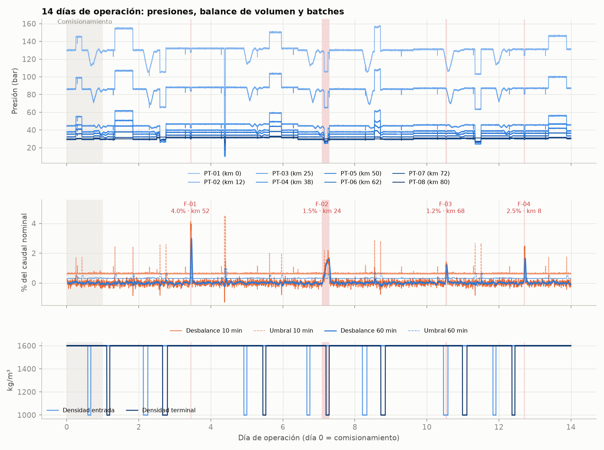
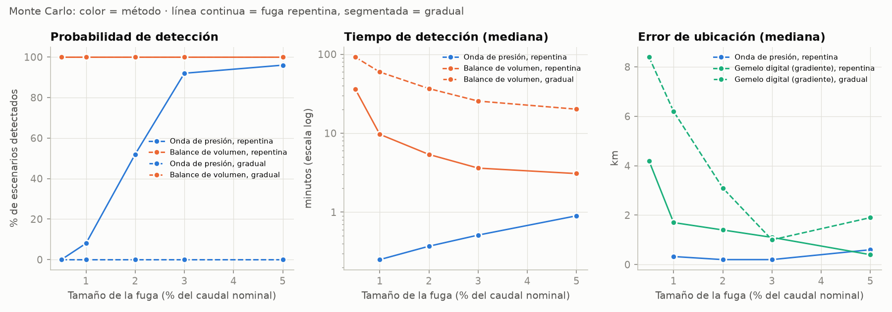
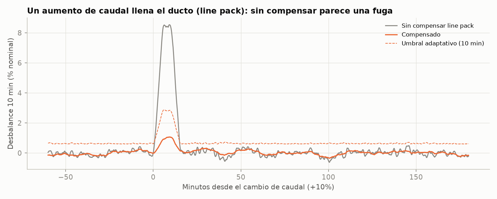

**Español** · [English](README.en.md)

# Monitoreo de un ducto de concentrado

Quería entender cómo se detectan y ubican fugas en un ducto de pulpa: qué datos entrega el SCADA, por qué se usan dos métodos distintos y cómo se lleva todo eso a un tablero de operación. No hay datos públicos de ductos mineros, así que armé un simulador y trabajé sobre datos sintéticos.

El caso es un ducto ficticio de concentrado de cobre de 80 km con 8 transmisores de presión, caudalímetros en la entrada y la salida, y 14 días de datos a 1 segundo. En esos 14 días hay cambios de caudal, rotación de bombas, batches de agua, dos fallas de instrumentos y cuatro fugas.

**Dashboard:** https://johnmoya.github.io/slurry-pipeline-monitor/



## Qué hace

- **Simulador** (`src/simulator.py`): genera la presión en cada estación con Darcy-Weisbach, el perfil de elevación y la densidad de cada batch. Las fugas y los cambios de operación producen ondas de presión que viajan a ~1.000 m/s. También simula el line pack y el ruido de los instrumentos.
- **Gemelo digital**: el mismo modelo hidráulico, alimentado solo con lo que se mide, estima cuál debería ser la presión en cada estación. Se calibra con el día 0.
- **Balance de volumen**: compara entrada con salida, corrige por line pack y usa ventanas de 2, 10 y 60 minutos.
- **Onda de presión**: busca escalones negativos en cada transmisor y ubica el origen por los tiempos de llegada. Si el origen está en la bomba o en el terminal, es una operación y se descarta.
- **Ubicación por gradiente**: para las fugas lentas, que no generan onda, el residuo del gemelo muestra dónde cambia la pendiente del gradiente hidráulico.
- **Envolvente**: MAOP por tramo, presión mínima en la línea y velocidad de deposición.
- **Salida**: un dashboard web, un modelo estrella en CSV y SQLite para Power BI, y medidas DAX.

## Resultados

| Fuga | Tipo | Tamaño | km real | La detectó | Primera alarma | km estimado | Error |
|---|---|---|---|---|---|---|---|
| F-01 | Repentina | 4,0 % | 52,3 | Onda + balance | 34 s | 52,0 | 0,35 km |
| F-02 | Gradual (3 h) | 1,5 % | 23,6 | Balance | 71 min | 19,8 | 3,8 km |
| F-03 | Repentina, con batch de agua en la línea | 1,2 % | 67,8 | Onda + balance | 18 s | 68,3 | 0,5 km |
| F-04 | Repentina, a 8 km de la bomba | 2,5 % | 8,4 | Balance | 5 min | 9,3 | 0,9 km |

Las cuatro fugas se detectaron sin falsas alarmas en los 13 días monitoreados. Se descartaron 23 transitorios de operación (rotación de bombas y ajustes de la válvula terminal).

Para ver qué tan bien funciona fuera de este escenario, corrí 250 escenarios con fugas de 0,5 a 5 % en puntos aleatorios, más 30 días sin fuga:

- La onda de presión es muy rápida (en mediana, menos de 1 minuto; el caso más lento tardó 1,3 min) y precisa (error mediano de 0,2 a 0,6 km), pero solo ve fugas repentinas: un 52 % de las de 2 % y un 92 % de las de 3 %.
- El balance detectó todas, incluso las de 0,5 %, pero más lento. En mediana tardó unos 4 min con una fuga repentina de 3 % y unos 92 min con una gradual de 0,5 %, que en el peor caso llegó a 2,4 horas.
- Las fugas que solo ve el balance se ubican con el gemelo. Desde un 3 %, el error mediano es de 2 km o menos. En las fugas chicas el residuo se confunde con el error del modelo: con una gradual de 0,5 % el error mediano es de 8 km, y en algunos casos la ubicación no sirve.
- En los 30 días sin fuga no hubo falsas alarmas confirmadas. Aparecieron 2 avisos de onda sin desbalance, que quedan como aviso para el operador.



## Cosas que no salieron a la primera

Esta es la parte que más me enseñó.

**El line pack.** La primera versión del balance daba una alarma en cada cambio de caudal. Al subir el caudal, la presión sube, la pulpa se comprime y el ducto "guarda" volumen, así que por unos minutos sale menos de lo que entra. Con la compensación bajaron mucho, pero seguían apareciendo en las rotaciones de bomba, porque la compensación tampoco es exacta (la velocidad de onda real no es la que asume el detector). Lo resolví subiendo el umbral en proporción a la corrección que se está aplicando en ese momento. Sin nada de esto, el mismo balance daba 42 falsas alarmas en 13 días.



**Instrumentos con falla.** Un pico en PT-02 y PT-05 congelado durante 3 horas metían escalones artificiales en la presión media, y eso contaminaba el balance. Ahora esos datos se detectan y se reemplazan por la estimación del gemelo.

**Ondas vistas solo de un lado.** F-03 está cerca del terminal, y la onda solo la vieron los transmisores de un lado. Con eso no se puede ubicar el origen exacto, solo acotarlo entre el primer transmisor que la vio y el primero que no. Tuve que agregar ese caso. Además, si el intervalo llega a la bomba o al terminal, no se puede descartar que sea una operación.

**Restar la línea base.** Para ubicar mejor con el gemelo probé restar el residuo de antes de la fuga. En las fugas repentinas mejoró la ubicación, pero en las graduales empeoró, porque esa "línea base" ya tenía la fuga creciendo adentro. Al final solo se resta cuando la onda de presión da la hora exacta de inicio.

**Cerca de la bomba.** La onda de F-04 no se detectó. La pulsación de las bombas mete ruido en los transmisores cercanos y la onda queda bajo el umbral, así que la detectó el balance a los 5 minutos. Es un límite real del método y se ve en el Monte Carlo.

## Simplificaciones

- El modelo es cuasi-estacionario con retardos de onda, no un transitorio completo: no hay reflexiones ni golpe de ariete.
- No modela flujo parcial (slack flow). La contrapresión del terminal lo evita, y la envolvente avisa si la presión mínima se acerca a ese límite.
- La pulpa es un fluido de densidad variable con fricción de Darcy. No modela reología ni deposición; la velocidad de deposición es un dato de diseño.
- Dejé a propósito diferencias entre el "ducto real" y el gemelo (rugosidad por tramo, velocidad de onda) para que el modelo tenga error, como pasa en la realidad.
- El factor de emisión es referencial.

## Cómo correrlo

```bash
pip install -r requirements.txt
python run_all.py
```

Demora alrededor de un minuto y genera `data/` (CSV y SQLite), `figures/` y `docs/index.html`. Con `--rapido` corre un Monte Carlo más chico.

En `powerbi/` están las medidas DAX y las notas para armar el modelo en Power BI.

```
src/config.py        parámetros del ducto, fluido e instrumentos
src/hydraulics.py    modelo hidráulico (lo usan el simulador y el gemelo)
src/simulator.py     SCADA sintético
src/scenarios.py     escenario de 14 días y escenarios del Monte Carlo
src/detection.py     gemelo, balance, ondas, ubicación, envolvente, batches
src/evaluation.py    comparación contra las fugas reales y Monte Carlo
src/export_bi.py     tablas para Power BI y SQL
src/export_web.py    dashboard web
web/dashboard.html   plantilla del dashboard
```

## Lo que haría después

- Leer desde PDF los informes de inspección (espesor de pared, rugosidad) y usarlos para recalibrar el gemelo y la MAOP de cada tramo.
- Recalibrar en continuo la fricción y el sesgo de los caudalímetros.
- Versionar los umbrales y parámetros de los detectores, para saber qué versión generó cada alarma.
- Un modelo transitorio completo, para ver cuánto afectan las reflexiones a la ubicación por onda.
